## About

I build AI agents and the developer tools around them, from retrieval and agent workflows to native macOS utilities and the APIs that hold them together.

- 🤖 **Agents:** LangGraph, RAG, tool calling, streaming, evaluation
- 🧱 **Full-stack:** TypeScript, React / Next.js, Python / FastAPI, Go
- 🍎 **Native:** Swift and SwiftUI on macOS
- ⚙️ I care about clear interface contracts, failures that recover, and tools people can actually understand.

## Toolbox

  

## GitHub Stats

  
  

  <picture>
    <source media="(prefers-color-scheme: dark)" srcset="./profile/snake-dark.svg" />
    
  </picture>

